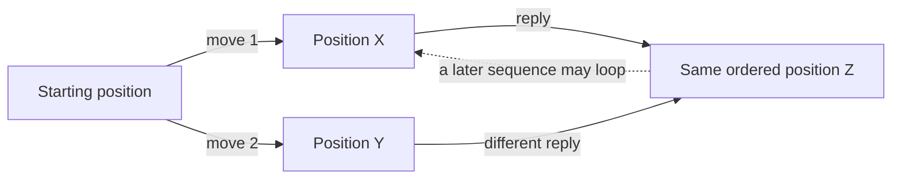
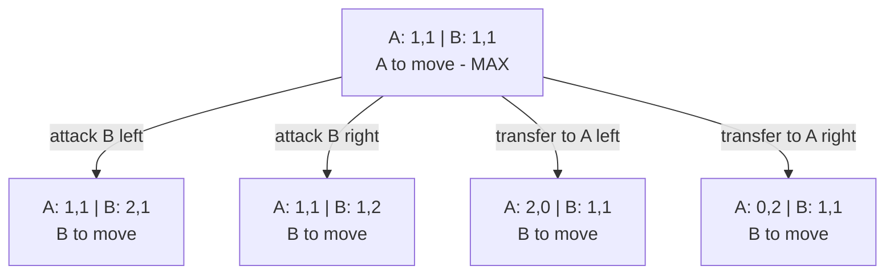
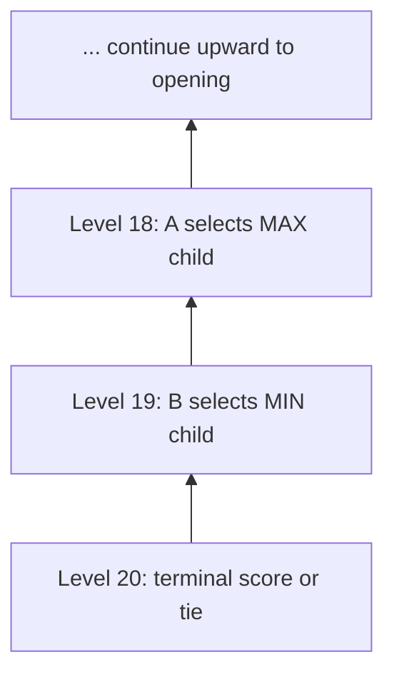
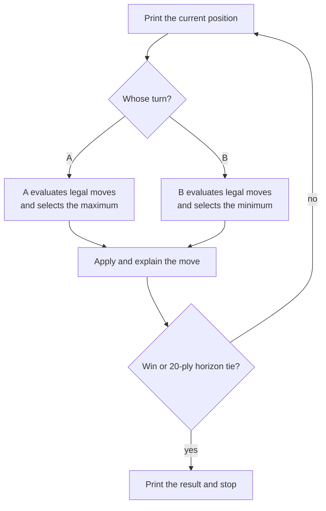

# Assignment 6: AI Logic and Move Graph

This document explains how the computer will represent Chopsticks, generate
all legal moves, and choose a move. The agreed rules are assumed throughout:
a hand becomes `0` when an attack makes it **5 or greater**, values do not
wrap around, and a transfer may revive or empty a hand while preserving the
player's total without being a no-op or a pure left/right swap.

## The Main Idea

The game will be stored as a **graph of positions**. When the computer must
move, minimax explores that graph as a temporary **search tree**:

- Player A is **MAX** and chooses the largest score.
- Player B is **MIN** and chooses the smallest score.
- Every score is measured from Player A's point of view.

Therefore, a positive score is good for A, a negative score is good for B,
and `0` represents an even result or a draw. The words *maximize* and
*minimize* refer to these scores, not to the number of moves or fingers.

## Graph Versus Search Tree

A tree records move sequences. If two different sequences arrive at the same
position, a plain tree repeats that position. Chopsticks also permits cycles:
a later split or series of attacks can return the game to a position seen
earlier.

A graph stores each unique position once and lets several move edges point to
it. This avoids rebuilding the same **ordered** position reached by different
move sequences. Mirrored left/right positions remain distinct graph nodes.



The starter's DP adds a **turn level** to each graph position. Reaching the
same ordered hands at level 6 and level 10 creates two different table
entries, because the number of turns remaining differs. Every move goes
from level `h` to `h + 1`, so the time-layered dependencies are acyclic even
when the base graph contains a loop.

## Ordered State Representation

A state needs both players' hands and the player whose turn it is:

```python
State = ((a_left, a_right), (b_left, b_right), turn)
```

For example:

```python
((0, 2), (1, 3), "A")
```

means A has `0 | 2`, B has `1 | 3`, and A moves next.

Each pair retains its left/right order after every move. Thus, `1 | 3` and
`3 | 1` are different stored positions, although a turn that merely swaps
those values is not a legal transfer. The turn remains in the key: the same
hands with A to move and B to move are different game states.

Under the cutoff rule, a live hand can contain `1`, `2`, `3`, or `4`, while a
dead hand contains `0`. An ordered pair can therefore be one of 25 values:

```text
(0,0) (0,1) (0,2) (0,3) (0,4)
(1,0) (1,1) (1,2) (1,3) (1,4)
(2,0) (2,1) (2,2) (2,3) (2,4)
(3,0) (3,1) (3,2) (3,3) (3,4)
(4,0) (4,1) (4,2) (4,3) (4,4)
```

This gives a simple upper bound on the base graph:

```text
25 hand pairs for A x 25 hand pairs for B x 2 possible turns = 1,250 states
```

The actual graph reachable from `1 | 1` versus `1 | 1` has **1,116 states**,
**4,080 directed move edges**, and **48 terminal states**; its largest
outdegree is **7**. Some combinations cannot occur and terminal positions do
not have outgoing moves. Adding turn levels enlarges the DP table beyond
these base-state counts; that distinction is explained below.

## Legal Moves Become Directed Edges

Every directed edge stores a legal action and its resulting ordered state.
For the player whose turn it is, move generation performs two tasks.

### Attack edges

1. Select one of the current player's live hands.
2. Select one of the opponent's live hands.
3. Add the attacker's value to the target.
4. Change the target to `0` if the result is 5 or greater.
5. Retain the hand order and pass the turn.

Dead hands cannot attack and cannot be targeted. If several physical choices
produce the same ordered result, the graph keeps one result edge with one
clear representative description.

### Split edges

1. Add the current player's two hand values.
2. Enumerate ordered pairs `(left, right)` where each value is from `0` to
   `4` and the sum equals that total.
3. Exclude the unchanged pair and a pure left/right swap.
4. Add each remaining pair as a move and pass the turn.

This allows a dead hand to be revived or a live hand to be emptied. For
example, `(0, 4)` may become `(2, 2)` or `(1, 3)`, and `(1, 3)` may become
`(0, 4)`. Merely reversing `(1, 3)` to `(3, 1)` is not a move under the
starter's transfer rule, despite being a different ordered state.

## Constructing the Reachable Graph with BFS

Breadth-first search (BFS) can begin at the standard initial state and visit
every reachable state. A queue holds states still to process, and a `seen`
set prevents a cycle from making construction run forever.

```python
start = ((1, 1), (1, 1), "A")
queue = deque([start])
seen = {start}
graph = {}

while queue:
    state = queue.popleft()
    graph[state] = []

    if winner(state) is not None:
        continue

    for move in legal_moves(state):
        child = apply_move(state, move)
        graph[state].append((move, child))

        if child not in seen:
            seen.add(child)
            queue.append(child)
```

This produces an adjacency list: each state maps to all of its outgoing
`(move, child_state)` edges. It is useful for explaining and inspecting the
whole reachable game. The starter-compatible `next_moves(v)` presents those
successors as time-layered tuple states for the DP table.

## How the Bottom-Up DP Backs Up Scores

The table uses only the starter's three exact outcomes, all measured from
Player A's point of view:

| Score | Meaning |
|---:|---|
| `+1` | A wins. |
| `0` | Both players survive the fixed horizon, so the game is a tie. |
| `-1` | B wins. |

At the final level (`20` by default), every position receives its terminal
win/loss score or `0` if both players remain alive. At each earlier level,
terminal wins are scored immediately. Every other position reads its
children from the *next* already-filled layer:

```python
if level % 2 == 0:             # A moves
    value = max(child_values)
else:                          # B moves
    value = min(child_values)
```

The table stores both `value` and the child state selected by that player.
When multiple children have the same value, a deterministic order picks one.
There is no heuristic: a nonterminal horizon position is an exact tie under
the assignment's fixed-horizon rule, not an estimate.

## Starter-Aligned Opening Example

From `A: 1 | 1`, `B: 1 | 1`, with A to move, the starter's ordered rule
generates **four distinct successor states**. Attacking with either of A's
equal hands produces the same outcome, so identical resulting states are
deduplicated; attacking B's left and right hands remains distinct.



This is one ply, not a complete minimax decision: A must also evaluate B's
best replies under every branch. At a B node, the lowest-valued continuation
is backed up; at the opening A node, the highest of those backed-up values is
chosen. The diagram shows the **legal move structure**, not a claimed best
opening move.

## What the 20-Ply Horizon Means

The starter calls `chopsticks_game(moves=10, ...)`, which sets
`depth = 2 * moves = 20`. That is **20 total individual actions in the whole
game**, not 20 positions, 20 unique states, or a new 20-ply lookahead on
each turn:

```text
level 0:  opening position; A to move
level 1:  after A's first move; B to move
level 2:  after B's first move; A to move
...
level 20: after the twentieth action; horizon tie if nobody won
```

The number of possible paths is much larger than the number of table
entries because paths to the same hand configuration at the same level
share one DP result. With five possible values per hand and 21 levels,
there are at most `5^4 × 21 = 13,125` table entries. The starter's
bottom-up process is therefore practical for this horizon.

## Table Key, Value, and Fill Order

`best_move_dp(depth=20)` uses the starter's tuple key and value shapes:

```python
key = ((a_left, a_right), (b_left, b_right), level)
value = (score, best_next_key)   # [] at a terminal or horizon position
```

At level 20, score each entry from the game result: A win `+1`, B win `-1`,
or unfinished tie `0`. Then visit levels 19, 18, ..., 0. A position where
someone has already lost keeps its terminal score. Otherwise, look up all
`next_moves(key)` at `level + 1` and retain the child with maximum score on
even A levels or minimum score on odd B levels. A deterministic tie-break
chooses between equally good children.



There is no threefold rule or path-history count. A repeated hand position
at a later level is a different table key because there are fewer turns
left. The fixed level always advances, so even a repeated base position
cannot stall the algorithm or game indefinitely.

## Autonomous Demonstration Mode

Autonomous mode uses the same state, move generator, rules, and minimax
function as human-versus-computer mode. There is no special scripted game:



After each move, the script will show the selected action, any arithmetic
used by an attack, the updated hands, and the score or short explanation that
made the move preferable. The normal outcomes are a win or an unfinished
game scored as a tie at the fixed horizon.

## Starter Function Mapping

| Starter function | Purpose |
|---|---|
| `overflow_sum(a, b)` | Add finger counts; return `0` at a sum of 5 or more. |
| `next_moves(v)` | Return ordered legal successor tuple states, each one level deeper. |
| `best_move_dp(depth)` | Fill the time-layered value/next-move table from `depth` down to 0. |
| `display(w)` | Show A's and B's hands. |
| `chopsticks_game(moves, index)` | Run a human/computer game; `moves=10` means 20 total plies. |

Our immutable game model, tested move graph, numbered input, and autonomous
mode extend those functions without altering their move and scoring rules.

## Implementation Summary

The implemented AI pipeline is:

1. Convert every position to an ordered immutable state.
2. Generate every unique ordered-result attack and transfer as a graph edge.
3. Build or explore the reachable graph without duplicating base states.
4. Make a 20-ply time-layered DP table, with the starter's `level` in each
   key and both value and best successor in each entry.
5. Score wins and losses immediately; score a still-live horizon position
   as a tie.
6. Back scores up from level 20 to level 0, using MAX for A and MIN for B.
7. Follow selected successors as play advances, with deterministic
   tie-breaking when child scores match.
8. Reuse exactly the same engine for human play and autonomous mode.

This design keeps the game rules independent from the AI. As features are
added, the command-line interface can change without changing what
constitutes a legal Chopsticks position or move.
