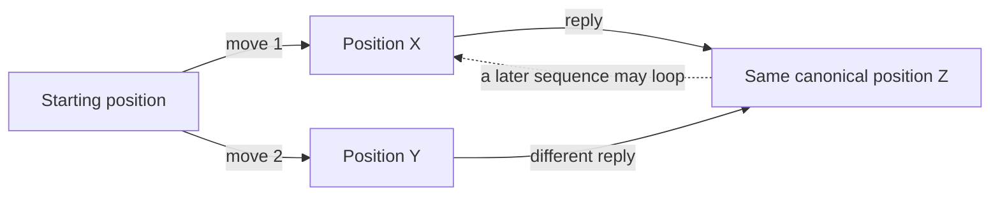
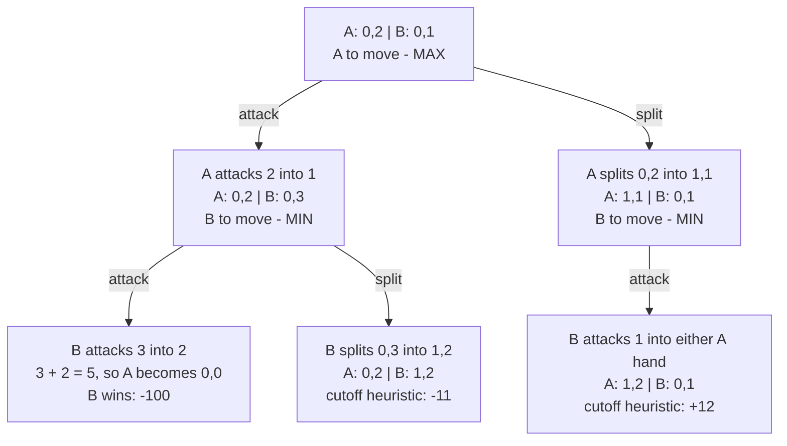
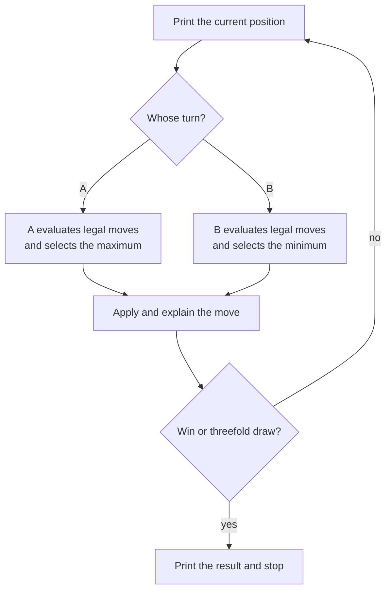

# Assignment 6: AI Logic and Move Graph

This document explains how the computer will represent Chopsticks, generate
all legal moves, and choose a move. The agreed rules are assumed throughout:
a hand becomes `0` when an attack makes it **5 or greater**, values do not
wrap around, a split may revive a dead hand, and a split must preserve the
player's total while producing a genuinely different pair of hands.

## The Main Idea

The game will be stored as a **graph of positions**. When the computer must
move, minimax explores that graph as a temporary **search tree**:

- Player A is **MAX** and chooses the largest score.
- Player B is **MIN** and chooses the smallest score.
- Every score is measured from Player A's point of view.

Therefore, a positive score is good for A, a negative score is good for B,
and `0` represents an even result or a draw. The words *maximize* and
*minimize* refer to these scores, not to the number of moves or fingers.

## Graph Versus Search Tree

A tree records move sequences. If two different sequences arrive at the same
position, a plain tree repeats that position. Chopsticks also permits cycles:
a later split or series of attacks can return the game to a position seen
earlier.

A graph stores each unique position once and lets several move edges point to
it. This avoids treating strategically identical positions as new positions.



Minimax still reasons in tree-shaped layers because reaching the same graph
node at different depths or with different repetition history can have a
different meaning. Memoization lets those layers share work when their full
search context is equivalent.

## Canonical State Representation

A state needs both players' hands and the player whose turn it is:

```python
State = ((a_low, a_high), (b_low, b_high), turn)
```

For example:

```python
((0, 2), (1, 3), "A")
```

means A has `0 | 2`, B has `1 | 3`, and A moves next.

Each pair is sorted into low-to-high order after every move. Thus, `1 | 3`
and `3 | 1` become the same canonical hand pair `(1, 3)`. Left and right are
useful display labels for a human, but swapping identical strategic roles
must not create a second graph node. The turn remains in the key: the same
hands with A to move and B to move are different game states.

Under the cutoff rule, a live hand can contain `1`, `2`, `3`, or `4`, while a
dead hand contains `0`. A sorted pair can therefore be one of 15 values:

```text
(0,0) (0,1) (0,2) (0,3) (0,4)
      (1,1) (1,2) (1,3) (1,4)
            (2,2) (2,3) (2,4)
                  (3,3) (3,4)
                        (4,4)
```

This gives a simple upper bound on the base graph:

```text
15 hand pairs for A x 15 hand pairs for B x 2 possible turns = 450 states
```

The actual graph reachable from `1 | 1` versus `1 | 1` is smaller because
some combinations cannot occur and terminal positions do not have outgoing
moves. Repetition history can enlarge the *search context* beyond these 450
base states; that distinction is explained below.

## Legal Moves Become Directed Edges

Every directed edge stores a legal action and its resulting canonical state.
For the player whose turn it is, move generation performs two tasks.

### Attack edges

1. Select one of the current player's live hands.
2. Select one of the opponent's live hands.
3. Add the attacker's value to the target.
4. Change the target to `0` if the result is 5 or greater.
5. Canonicalize both hand pairs and pass the turn.

Dead hands cannot attack and cannot be targeted. If several physical choices
produce the same canonical result, the graph keeps one result edge with one
clear representative description.

### Split edges

1. Add the current player's two hand values.
2. Enumerate pairs `(x, y)` where `1 <= x <= y <= 4` and `x + y` equals that
   total.
3. Exclude the current canonical pair, because a player must change the
   position.
4. Add each remaining pair as a move and pass the turn.

This allows a dead hand to be revived. For example, `(0, 4)` may become
`(2, 2)` or `(1, 3)`. Merely reversing `(1, 3)` to `(3, 1)` is not a move,
because both forms have the same canonical representation.

## Constructing the Reachable Graph with BFS

Breadth-first search (BFS) can begin at the standard initial state and visit
every reachable state. A queue holds states still to process, and a `seen`
set prevents a cycle from making construction run forever.

```python
start = ((1, 1), (1, 1), "A")
queue = deque([start])
seen = {start}
graph = {}

while queue:
    state = queue.popleft()
    graph[state] = []

    if winner(state) is not None:
        continue

    for move in legal_moves(state):
        child = apply_move(state, move)
        graph[state].append((move, child))

        if child not in seen:
            seen.add(child)
            queue.append(child)
```

This produces an adjacency list: each state maps to all of its outgoing
`(move, child_state)` edges. It is useful for explaining and inspecting the
whole reachable game. Minimax may also generate these edges on demand rather
than requiring the complete graph to be rebuilt before every game.

## How Minimax Backs Scores Up the Tree

At a terminal node:

- A win receives a large positive score, such as `+10_000`.
- A loss for A (a B win) receives a large negative score, such as `-10_000`.
- A draw receives `0`.

At a nonterminal depth cutoff, a small heuristic estimates the position. A
transparent first heuristic could be:

```python
heuristic = (
    10 * (a_live_hands - b_live_hands)
    + (sum(a_hands) - sum(b_hands))
)
```

This estimate is intentionally much smaller than a terminal score. It can be
refined later with immediate threats and legal-move counts; it is an
estimate, not a game rule.

For any nonterminal state, minimax evaluates all legal children and then
backs one value up:

```python
if state.turn == "A":
    value = max(child_values)
else:
    value = min(child_values)
```

Adding the remaining depth to a winning terminal score makes A prefer a
faster win. Subtracting it from a losing terminal score makes B prefer a
faster B win. Terminal scores must still stay outside the complete range of
the heuristic.

## Fully Legal Two-Ply Example

Consider this position under the agreed rules:

```text
Player A: 0 | 2
Player B: 0 | 1
Turn: Player A (MAX)
```

One **ply** is one player's action. The diagram searches two plies: A chooses
a move and then B chooses a reply. The nonterminal leaves use the small
heuristic above solely to make the score calculation visible. For readability,
this small diagram abbreviates the terminal magnitude to `100`; the program
can use the larger `10_000` magnitude described above.



The leaf calculations are:

```text
B's winning attack:                         -100 (terminal example value)
A 0,2 versus B 1,2: 10 x (1 - 2) + (2 - 3) = -11
A 1,2 versus B 0,1: 10 x (2 - 1) + (3 - 1) = +12
```

At the left B node, B is MIN and chooses the smaller value:

```text
min(-100, -11) = -100
```

At the right B node, B has only one unique move, because attacking either of
A's equal hands produces the same canonical state. Its value is `+12`.
Finally, A is MAX and compares the values backed up from its two choices:

```text
max(-100, +12) = +12
```

Consequently, A chooses the split. Minimax does not assume B will cooperate;
it judges each A move by the strongest reply B can make.

## What a Depth of 50 Means

The planned search depth is **50 plies**, not 50 nodes and not necessarily 50
unique states:

```text
depth 1:  A's candidate move
depth 2:  B's reply
depth 3:  A's next move
...
depth 50: the fiftieth individual action
```

The number of examined nodes may be much larger because every legal move can
branch into several replies. A terminal result or draw stops a branch before
the depth limit. If a branch reaches depth zero without ending, the heuristic
supplies its leaf value.

## Alpha-Beta Pruning

Alpha-beta pruning returns the same selected move as full minimax while
skipping branches that cannot change the answer.

- `alpha` is the best score MAX can already guarantee.
- `beta` is the best score MIN can already guarantee.
- When `alpha >= beta`, the remaining siblings cannot affect an ancestor's
  decision and may be skipped.

Good move ordering makes pruning more effective: immediate wins, forced
knockouts, and defensive moves can be examined before quiet moves. Pruning
does not change the rules or invent a score; it only avoids unnecessary
work.

## Memoization and Repeated Positions

Memoization stores a previously calculated answer so an equivalent search
does not solve the same subproblem again. At minimum, a safe cache key needs
the canonical state and remaining depth. If a pruned result is cached, the
entry must also record whether it is an exact value, a lower bound, or an
upper bound; the simpler first implementation can cache only fully evaluated
exact results.

Threefold repetition adds an important history caveat. A draw occurs when
the same complete position—including whose turn it is—appears for the third
time. Whether a position is the first or third occurrence cannot be learned
from the base state alone. The current state is already counted when a search
function begins. Before recursing, the program counts the selected child and
then restores that count when it returns:

```python
history[child] += 1
try:
    child_value = search(child, history)
finally:
    history[child] -= 1
    if history[child] == 0:
        del history[child]
```

Accordingly, a repetition-aware cache must include the relevant history
signature in its key, or avoid reusing cached values when path history could
change the result. The 450-state calculation counts only base positions; it
does not count these history-augmented search situations. Actual gameplay
should maintain occurrence counts across the full played game as well.

## Autonomous Demonstration Mode

Autonomous mode uses the same state, move generator, rules, and minimax
function as human-versus-computer mode. There is no special scripted game:



After each move, the script will show the selected action, any arithmetic
used by an attack, the updated hands, and the score or short explanation that
made the move preferable. A final turn cap can remain as a defensive software
safeguard, but the normal rule-based outcomes are a win or a threefold draw.

## First-Iteration Search Status

The first version of `chopsticks.py` builds the complete 342-state reachable
graph and performs history-aware alpha-beta minimax with a 50-ply horizon.
Both the real game and every simulated search path carry occurrence counts,
so a third occurrence at any searched ply receives a draw score.

A separate memoized `(state, depth)` table supplies promising move order only.
Because its estimates do not become final scores, its lack of repetition
history cannot change the answer; it merely helps alpha-beta pruning reach
that answer faster. The final score always comes from the history-aware
search.

## Implementation Summary

The proposed AI pipeline is:

1. Convert every position to a canonical immutable state.
2. Generate every unique legal attack and split as an outgoing graph edge.
3. Build or explore the reachable graph without duplicating base states.
4. Search up to 50 alternating plies with A as MAX and B as MIN.
5. Stop at wins, losses, threefold repetitions, or the depth cutoff.
6. Use terminal scores or the cutoff heuristic and back values toward the
   current position.
7. Accelerate the search with alpha-beta pruning and history-safe
   memoization.
8. Reuse exactly the same engine for human play and autonomous mode.

This design keeps the game rules independent from the AI. As features are
added, the command-line interface and scoring heuristic can change without
changing what constitutes a legal Chopsticks position or move.
