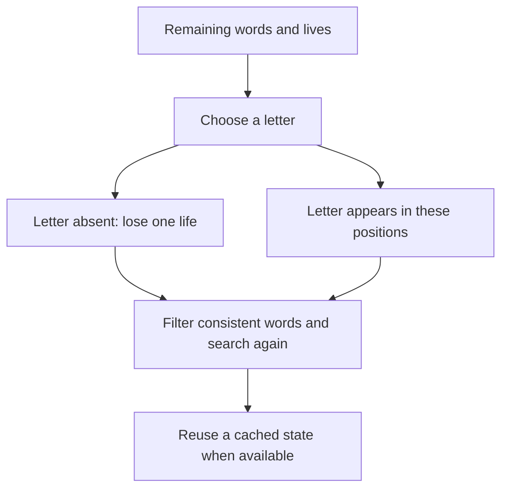

# JON17006 Hangman bot

## Collect an observed bank and use the decision graph

Run this command in your own PowerShell terminal after opening the class website:

```powershell
python collect_words.py --name JON17006 --url https://hangman-ex89.onrender.com
```

It runs exactly one complete official evaluation using a fixed dictionary bot. After each game is won or lost, it checkpoints the revealed answer to `data/observed_words.txt`. Raw final results and collection metadata are saved under `results/`. It never reads a playing game's answer and never skips or restarts games. Words collected during this run do not change the bot playing that run.

Brief Windows file locks are retried. If a project file stays locked, the collector writes a recovery copy under the Windows temporary folder and prints its exact location. Checkpoint/storage failures do not stop an active evaluation. Later successful saves restore the usual project files. Previously saved recovery-bank words are merged on the next run. If both locations fail, the collector keeps the latest words in memory and warns you to keep the terminal open.

To continue an interrupted evaluation that the server still considers active, copy its evaluation ID from the `Started evaluation ...` line:

```powershell
python collect_words.py --resume EVALUATION_ID
```

This continues that same session without choosing a new word, skipping a game, or starting a replacement run. An abandoned/expired evaluation cannot be resumed. The collector never automatically creates a replacement evaluation.

An evaluation contains 300 games. This does not establish that the server contains exactly 300 unique words, that all 300 will be distinct, or that the next evaluation will use the same bank. The supplied public lists already contain 633 distinct words.

`tree_bot.py` uses the collected bank when present, or the public assignment lists before collection. Each graph node is `(consistent words, remaining lives)`. Edges correspond to guessing a letter and observing its complete position mask; the empty mask costs one life. Exact cached search maximizes expected wins, then remaining lives, assuming equally likely candidate words. Search limits use a fallback policy and do not constitute a proof of optimality. Words outside the observed bank use the broader English fallback.



Test the tree locally, including all supplied words:

```powershell
python -m unittest test_bots test_collection_tree -v
python benchmark.py --bot tree_bot:TreeBot --output results/tree_public_known.json
```

After collection, test the observed bank locally:

```powershell
python benchmark.py --bot tree_bot:TreeBot --training data/observed_words.txt --test data/observed_words.txt --output results/tree_observed_known.json
```

This last comparison measures performance on training words, not generalization to a new server bank. To run a later official comparison after reviewing local results:

```powershell
python tree_bot.py --evaluate --name JON17006-Tree --url https://hangman-ex89.onrender.com
```

The original `my_bot.py` implements `choose_letter(state)` using the public assignment lists and general English corpus. The tree bot can additionally use answers observed after completed games. Neither strategy reads a hidden answer during play or obtains upcoming words, game logs, or replays.

## Run

Python 3.10 or later is required. The project uses the Python standard library, with no required pip packages.

Open a terminal in this folder. First visit https://hangman-ex89.onrender.com/ and wait for the website to load, as the assignment requires.

Practice:

```powershell
python my_bot.py --difficulty easy --games 20 --url https://hangman-ex89.onrender.com
python my_bot.py --difficulty medium --games 20 --url https://hangman-ex89.onrender.com
python my_bot.py --difficulty hard --games 20 --url https://hangman-ex89.onrender.com
```

Official evaluation:

```powershell
python my_bot.py --evaluate --name JON17006 --url https://hangman-ex89.onrender.com
```

Let all 300 games finish. The supplied assignment states no one-attempt restriction or maximum number of completed runs. Each interrupted run is abandoned; only completed runs appear on the leaderboard. This statement describes the provided assignment text, not an independent guarantee about server limits.

After a completed official evaluation, take a screenshot of the website showing JON17006, rank, and win rate. The assignment requires bot code and this screenshot. Local benchmark results are not a substitute for the official screenshot.

## How the strategy works

1. `my_bot.py` checks the supplied training dictionary for words compatible with every public clue.
2. `strategy_dictionary.py` compares exact letter positions, including the rule that all occurrences of a guessed letter are revealed. It considers hit probability and information gained, then plans small endgames to maximize wins before remaining lives.
3. If no supplied word matches, `strategy_general.py` uses a broader public dictionary and character contexts learned from training words to predict missing letters. It still guesses when the word is absent from every dictionary.
4. `bot_examples/runner.py` starts games, sends one letter at a time, and prints results. Its helper imports were corrected to work from the project root.

Training sources are documented in `data/SOURCES.md`. The bundled extra dictionary is a general English frequency list and includes some names and abbreviations.

## Reproduce local comparisons

These commands simulate games entirely on this computer and do not create leaderboard entries:

```powershell
python -m unittest test_bots -v
python experiments.py --suite known
python experiments.py --suite class_holdout --seed 42
python experiments.py --suite broad_holdout --seed 4095 --games 300
```

`known` tests words included in training, so it primarily measures dictionary coverage. `class_holdout` removes 25% of the public class words from **all** training sources, including the expanded dictionary. `broad_holdout` holds out general public words. The same test games are used for every strategy in a comparison. These samples differ from the server's hidden official evaluation.

For custom comparisons, use `benchmark.py --help`. Explicit `words=...` constructor arguments replace bundled training data to prevent holdout leakage.

Local summaries and detailed game traces are saved under `results/`. Local secrets in those trace files belong only to the simulator and are never sent to a strategy as a playing state.

## Current server access

On 2026-10-08, terminal requests could not resolve the server hostname and browser access was rejected because permission was declined. No remote practice or official evaluation has been completed in this session. The commands above are ready for an environment with access to the class server.
